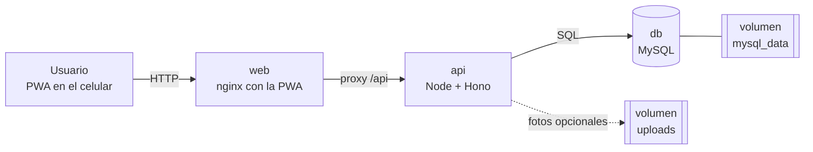
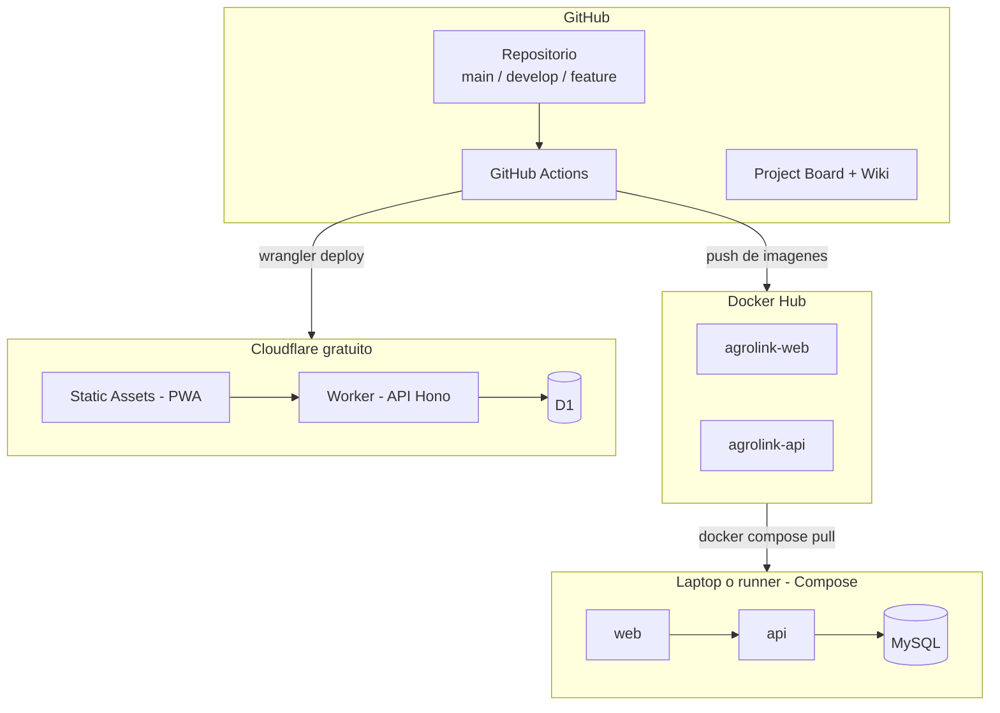
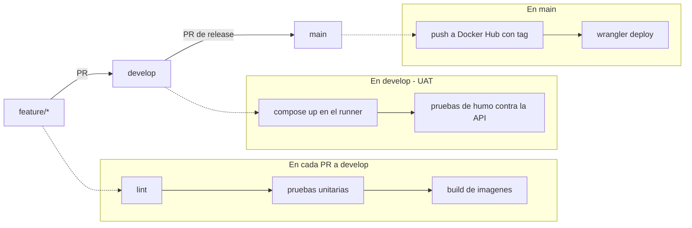
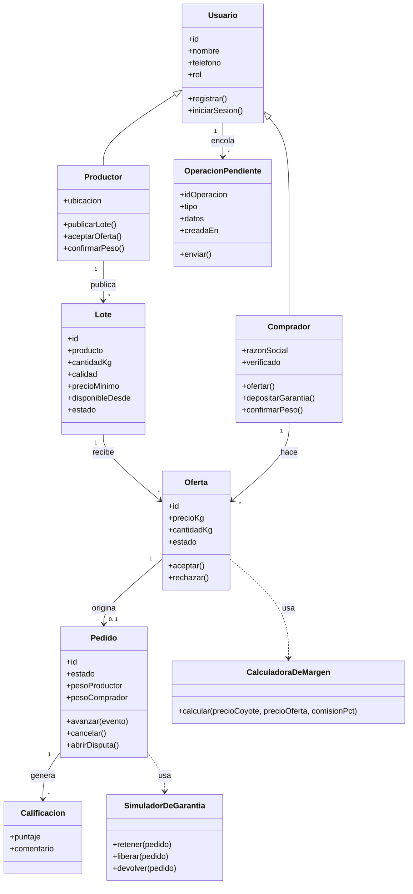
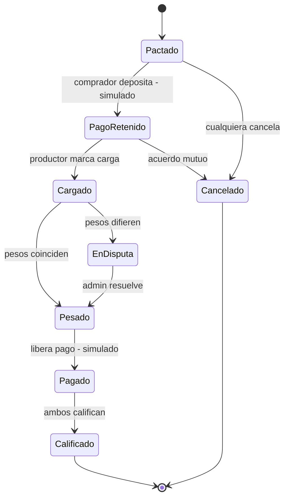
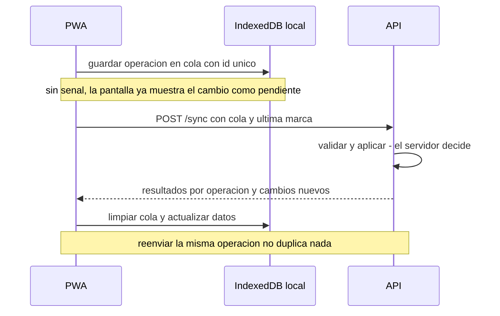

# 03 · Arquitectura

Los diagramas están en Mermaid (se ven en GitHub y en la Wiki) y como PNG en `docs/diagramas/` para el PDF.

Estado: **Propuesto** (salvo Kubernetes descartado = **Decidido**, ver ADR-001).

## Qué corre dónde (capa gratuita)

Verificado en octubre de 2026 en documentación oficial y comparativos; volver a revisar antes de la demo porque estos límites cambian.

| Pieza | Dónde | Límite relevante | Nota |
|---|---|---|---|
| Código, issues, Project Board, Wiki, CI | GitHub | CI gratuita en repos públicos | Repo público para no gastar minutos |
| Imágenes Docker | Docker Hub (repo público) | Repos públicos ilimitados | Requisito del curso. Usar un token con permiso de escritura |
| PWA + API para la demo pública | Cloudflare Workers (Static Assets) | 100,000 solicitudes/día; **10 ms de CPU por solicitud**; 50 subsolicitudes | Suficiente para demo; las consultas deben ser ligeras |
| Base de datos de la demo | Cloudflare D1 | 5 GB; 5 M lecturas/día; 100 mil escrituras/día | Es SQLite |
| Fotos (opcional) | Cloudflare R2 | 10 GB | Should (S4) |
| Sistema en contenedores (Infra) | Docker Compose en la laptop y en el runner de CI | Sin costo | Se muestra en clase y se prueba en el pipeline |
| Hosting de Compose en la nube | **No se usa** | Render gratis se duerme tras 15 min, sin disco persistente, Postgres caduca a 30 días; Fly.io ya no tiene plan gratis; Koyeb pide tarjeta y no da volúmenes; Oracle pide tarjeta, redujo su cuota (2 OCPU/12 GB) y suele quedarse sin capacidad | Si se quisiera, Oracle es la única con recursos reales, pero con riesgo |

**Consecuencia:** el curso de Infra se demuestra con Compose + pipeline + Docker Hub; la materia de Innovación se demuestra con la URL pública en Cloudflare. Es **un solo código** (ver ADR-002).

## Vista de contenedores (modo Compose)

## Vista de despliegue (los dos destinos)

## Pipeline y ramas

Ramas: `main` (estable, lo que se demuestra) · `develop` (integración) · `feature/<issue>-<nombre>` (trabajo). Todo entra por Pull Request.

## Modelo de clases

Es el diagrama de "componentes y métodos" que pide la rúbrica de Infra. Se refina al implementar.

## Estados del pedido

## Sincronización sin señal

## Un API, dos destinos (resumen de ADR-002)

- El API está escrito en **Hono**, que corre igual en Node (Compose) y en Workers (Cloudflare).
- El acceso a datos pasa por una capa de repositorios con dos adaptadores: MySQL para Compose y D1 para Cloudflare.
- Las consultas usan el subconjunto común de SQL (parámetros `?`, ids de texto generados por la app, fechas en formato ISO). Solo el DDL (crear tablas) difiere entre `db/migrations/mysql` y `db/migrations/d1`.
- **Plan B si se complica:** usar SQLite en ambos destinos (archivo en volumen en Compose, D1 en Cloudflare). Un solo dialecto, pero el servicio `db` desaparece de Compose; hay que confirmar con el profesor si la rúbrica exige un contenedor de base de datos.
